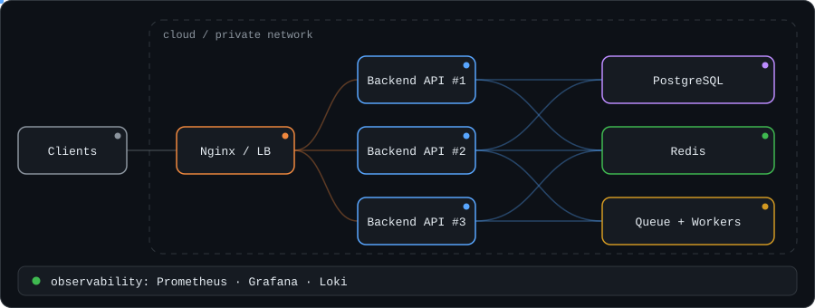
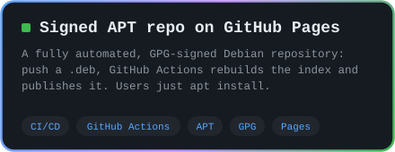

<!-- Generated by generate.py from profile.json - edit profile.json, then run: python3 generate.py -->

  

 

### How I ship

### How I think about systems

### What is running

                        

### Featured projects

<table>
  <tr>
    <td width="50%" align="center"></td><td width="50%" align="center"></td>
  </tr>
</table>

### Contribution snake

  <picture>
    <source
      media="(prefers-color-scheme: dark)"
      srcset="https://raw.githubusercontent.com/zeyadzero/zeyadzero/output/github-contribution-grid-snake-dark.svg"
    />
    <source
      media="(prefers-color-scheme: light)"
      srcset="https://raw.githubusercontent.com/zeyadzero/zeyadzero/output/github-contribution-grid-snake.svg"
    />
    
  </picture>

