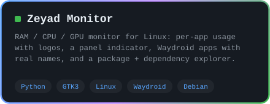
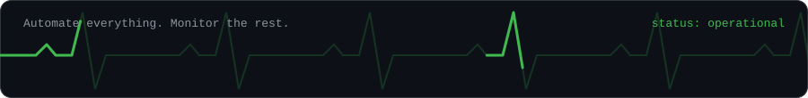

<!-- Generated by generate.py from profile.json - edit profile.json, then run: python3 generate.py -->

  

 

### How I ship

### How I think about systems

### What is running

         

### Featured projects

<table>
  <tr>
    <td width="50%" align="center"></td><td width="50%" align="center"></td>
  </tr>
</table>

### Contribution snake

<picture>
  <source media="(prefers-color-scheme: dark)" srcset="https://raw.githubusercontent.com/zeyadzero/zeyadzero/output/github-snake-dark.svg"/>
  <source media="(prefers-color-scheme: light)" srcset="https://raw.githubusercontent.com/zeyadzero/zeyadzero/output/github-snake.svg"/>
  
</picture>

